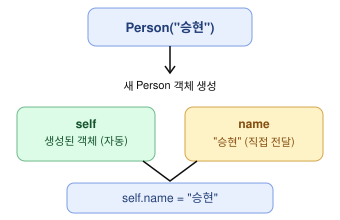

# `__init__`과 `self`

핵심: **`self`는 파이썬이 자동으로 전달해 주기 때문에 객체를 만들 때 직접 넣지 않는다.**



## 1. 클래스 정의

```python
class Person:
    def __init__(self, name):
        self.name = name
```

`__init__`의 매개변수는 2개다.

- `self`: 새로 생성된 객체 자기 자신
- `name`: 사용자가 전달한 값

그런데 객체를 만들 때는 값을 하나만 전달한다.

```python
person = Person("승현")
```

## 2. 파이썬 내부에서는 어떻게 동작할까?

`Person("승현")`을 호출하면 파이썬은 내부적으로 다음과 비슷한 일을 한다.

```python
person = Person.__new__(Person)    # 1. 빈 객체 생성
Person.__init__(person, "승현")     # 2. 그 객체를 self로 넘겨서 초기화
```

즉 `self`에는 새로 생성된 객체가 자동으로 들어가고, `name`에는 `"승현"`이 들어간다.

## 3. 직접 확인해 보기

```python
class Person:
    def __init__(self, name):
        print(self)
        print(name)
        self.name = name


person = Person("승현")
print(person)
```

출력:

```
<__main__.Person object at 0x102bf1cd0>
승현
<__main__.Person object at 0x102bf1cd0>
```

첫 번째와 마지막 줄의 주소가 같다. `__init__` 안의 `self`와 밖의 `person`은 **같은 객체**를 가리킨다.
(주소값은 실행할 때마다 달라진다.)

## 4. JavaScript와 비교

```javascript
class Person {
    constructor(name) {
        this.name = name;
    }
}

const person = new Person("승현");
```

```python
class Person:
    def __init__(self, name):
        self.name = name


person = Person("승현")
```

| | JavaScript | Python |
|---|---|---|
| 생성자 | `constructor` | `__init__` |
| 자기 자신 | `this` | `self` |
| 자기 자신 선언 | 안 함 (암묵적) | 첫 번째 매개변수로 **명시** |
| 객체 생성 | `new Person("승현")` | `Person("승현")` (`new` 없음) |

## 정리

`Person("승현")`을 호출하면 `self`는 파이썬이 알아서 전달하고, 직접 넣은 `"승현"`은 `name`으로 전달된다.
